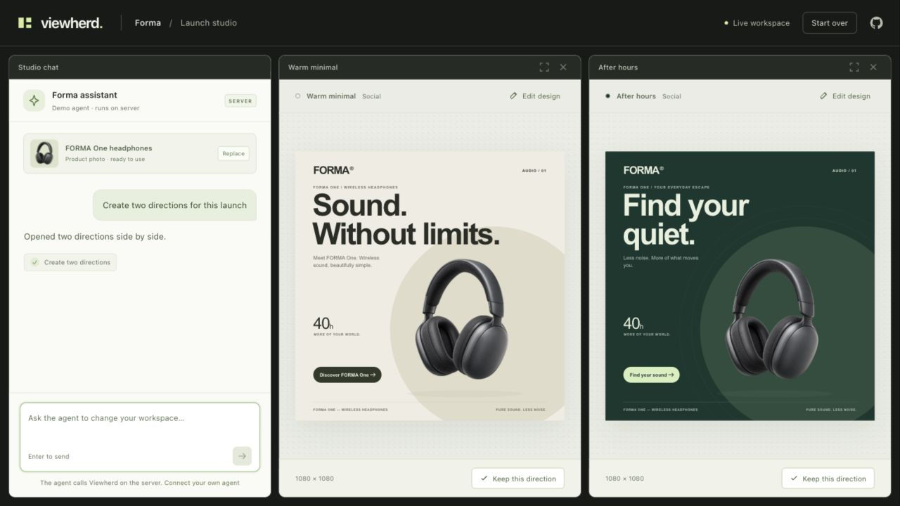

# Viewherd

Build web apps that people and AI agents can use together.

Viewherd adds tabs and split panels to your app. Agents can open panels, change what's inside them, and take the actions you allow. People see the changes and can keep working in the same app.

[](docs/demo.mp4)

[Watch the demo](docs/demo.mp4)

## Try it

Install Node.js 18 or newer, then run:

```sh
git clone https://github.com/shaumik/viewherd.git
cd viewherd
npm install --offline --ignore-scripts
npm run example
```

Open [localhost:4317](http://localhost:4317).

The example is a product launch studio. Ask “Create two directions,” then “Keep the dark one and make it cobalt.” Chat opens and changes real panels. Export the finished design.

It runs without an API key using a demo agent on the server. [Connect a real model or your own agent](docs/AGENTS.md).

## Use it in your app

Follow the [SDK guide](docs/SDK.md). The SDK packages are included in this repo and are not on npm yet.

[MIT licensed](LICENSE).
