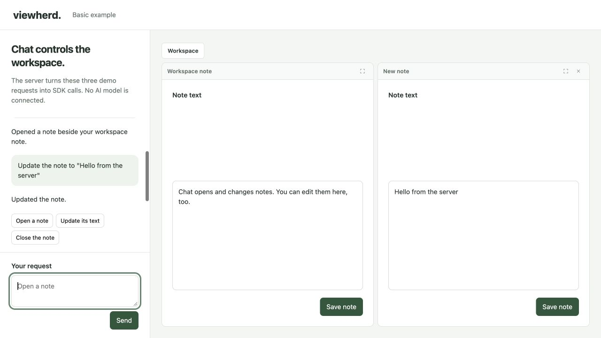

# Basic example

A chat on the left opens, edits and closes real panels on the right.



From the repository root:

```sh
npm install --offline --ignore-scripts
npm run example:basic
```

Open http://localhost:4318. Try the three request buttons.

Read these files in order:

1. [panels.mjs](panels.mjs): define a note and its allowed actions.
2. [server.mjs](server.mjs): call those actions from the backend.
3. [client.js](client.js): render notes and receive live updates.

This is a small command interpreter, not an AI model. Replace it with your agent's tool calls. The same actions are available over HTTP and MCP.

The server runs on localhost with one demo user and an in-memory session. Add your app's authentication and a durable store before deploying it.
